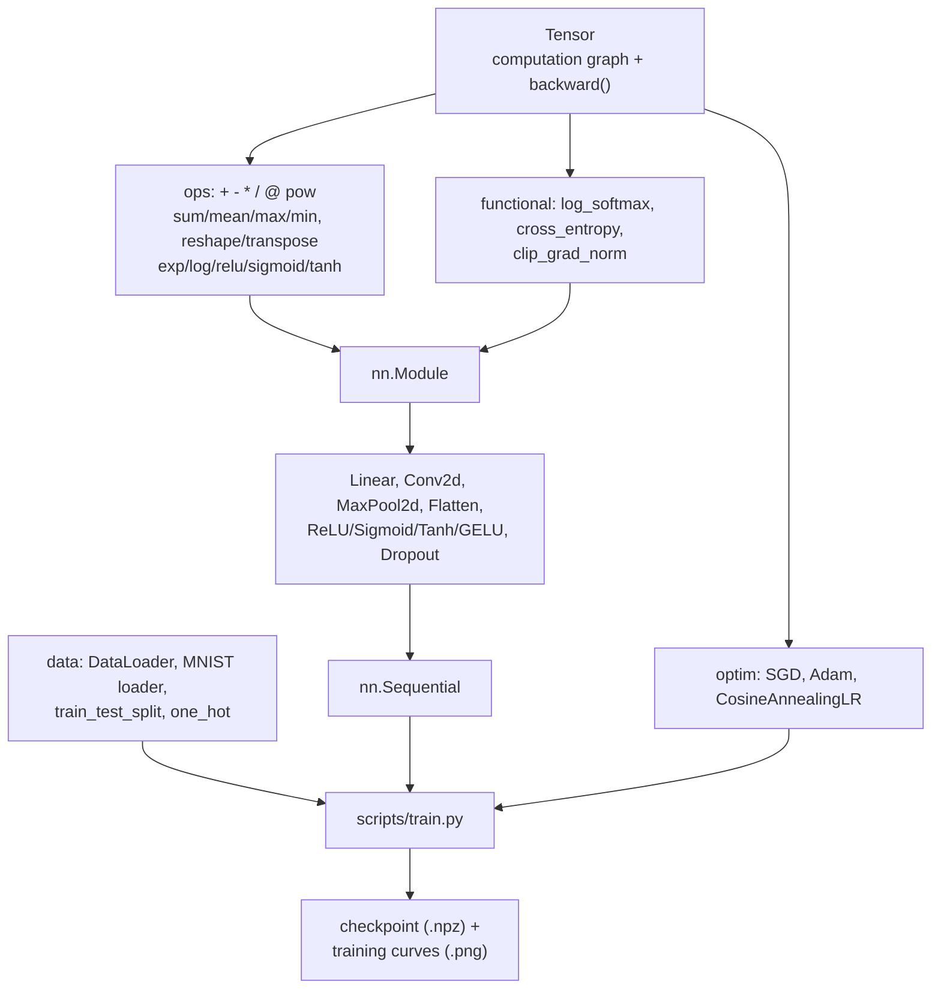

# numgrad

[](https://github.com/DanHashes/numgrad/actions/workflows/ci.yml)

A reverse-mode automatic differentiation engine and small deep learning
framework, built on nothing but NumPy. No PyTorch, no autograd libraries —
`Tensor` and its computation graph, every op's gradient, the training loop,
and the convolution are all code in this repo.

Most "ML project" repos are a notebook that calls `model.fit()`. This one is
different on purpose: every line of math here is something you can be asked
to derive on a whiteboard, and the answer is sitting in code that's
gradient-checked and tested, not asserted. See `docs/math.md` for the actual
derivations and `docs/profiling.md` for where the time and memory actually
go (including a bug the profiler caught, not just confirmed).

## Results

Trained on real MNIST (60k train / 10k test), full numbers and training
curves in `PROGRESS.md` (Step 8) and `docs/assets/`:

| Model | Architecture | Epochs | Test accuracy |
|---|---|---|---|
| MLP | 784→256→128→10, dropout 0.2 | 15 | **98.13%** |
| CNN | conv(8)→pool→conv(16)→pool→64→10 | 8 | **98.77%** |

```bash
python scripts/train.py --model mlp --epochs 15 --optimizer adam --lr 1e-3
python scripts/train.py --model cnn --epochs 8  --optimizer adam --lr 1e-3
```

## Quickstart

```bash
git clone https://github.com/DanHashes/numgrad.git
cd numgrad
pip install -e ".[dev]"
pytest                              # 284 tests, network-free (~6s)
python scripts/train.py --synthetic --epochs 3   # no download needed
```

```python
import numpy as np
from numgrad import Tensor, cross_entropy
from numgrad.nn import Linear, ReLU, Sequential
from numgrad.optim import Adam

model = Sequential(Linear(4, 8), ReLU(), Linear(8, 3))
x = Tensor(np.random.randn(5, 4))
targets = np.array([0, 1, 2, 0, 1])

opt = Adam(model.parameters(), lr=1e-2)
for _ in range(100):
    opt.zero_grad()
    loss = cross_entropy(model(x), targets)
    loss.backward()
    opt.step()
```

## Architecture



Everything downstream of `Tensor` — layers, losses, optimizers — is built
purely by composing `Tensor` ops; only `Conv2d`/`MaxPool2d` (im2col/col2im)
and the arithmetic/reduction ops themselves have hand-written backward
passes. `cross_entropy` and `GELU`, for instance, have none at all — their
gradients fall out automatically from composing already-correct primitives.

## Benchmarks: why vectorization matters

Naive pure-Python loops vs. the vectorized `Tensor`/NumPy implementation,
same computation, same machine (`benchmarks/`):

| Benchmark | Sizes | Speedup |
|---|---|---|
| Elementwise multiply + sum (`bench_naive_vs_vectorized.py`) | up to 1024×1024 | **~4×–40×** |
| 2D convolution, naive 4-nested-loop vs. im2col+matmul (`bench_conv.py`) | up to (4,8,32,32) batch/channels, 3×3 kernel | **~16×–500×** |

Both run reproducibly with `python benchmarks/<script>.py`. The gap exists
because NumPy pushes the same arithmetic down into contiguous-memory,
BLAS-backed (or SIMD-vectorized) C loops, instead of paying Python's
per-element interpreter, boxing, and bounds-checking overhead on every
single operation — see `docs/profiling.md` for a second, subtler instance of
the same lesson: `np.einsum` was 3–4.5× slower than an equivalent `@`
(matmul) expression for the *exact same math*, because `einsum`'s
general-purpose evaluator doesn't route through BLAS the way `matmul` does.

## Design decisions

- **Broadcasting-aware gradients, one helper, not one per op.** Every
  broadcasting op (`+`, `-`, `*`, `/`, `@`) routes its backward through a
  single `_unbroadcast(grad, target_shape)` function rather than re-deriving
  "which axes got broadcast" per operator. This is also where the first real
  bug surfaced and got fixed (see `PROGRESS.md` Step 2) — having one place
  for this logic is what made that bug easy to isolate.
- **Backward closures are pure functions of the incoming gradient, never of
  a node's `.grad`.** The first implementation read the output node's
  `.grad` directly (the natural micrograd-style approach) and it silently
  produced *wrong, compounding* gradients on a second `.backward()` call.
  Fixed by making every `_backward(grad_output)` return `(parent,
  contribution)` pairs with no shared mutable state — see `PROGRESS.md`
  Step 2 and `CONTRIBUTING.md` for the pattern new ops should follow.
- **The log-sum-exp trick, and why it's safe to differentiate straight
  through it.** `log_softmax` subtracts the row max before exponentiating
  for numerical stability — standard. Less obviously: differentiating
  *through* that max subtraction (rather than treating it as a detached
  constant) still gives the textbook-exact gradient, because the max's own
  gradient terms cancel out algebraically in the full expression. Derived in
  full in `docs/math.md` §3.
- **im2col over a naive loop, with `col2im` as its true gradient inverse,
  not a re-run of im2col.** `im2col` reads via a strided NumPy *view* (safe,
  since reads can alias); `col2im` must scatter-add into overlapping
  regions, which a view can't do — so it's deliberately a different
  function, looping over kernel positions (fixed, small) rather than output
  pixels. See `docs/math.md` §4 for the derivation and `docs/profiling.md`
  for what this trades (an ~11× memory increase over the MLP) for the
  100×+ speedup it buys.
- **Finite-difference gradient checking as the correctness contract**, not
  just spot-checked examples. Every op, every layer, and the full
  `Conv2d → MaxPool2d → Flatten → Linear` stack end to end are checked
  against numerical gradients (`tests/helpers.py::gradcheck`) across
  multiple random seeds and shapes — this is what caught the Step 2
  compounding-gradient bug and the Step 4 sigmoid-overflow bug before either
  shipped.
- **`src/` layout + strict `mypy`/`ruff`.** The layout costs one extra
  directory level in exchange for guaranteeing the installed package (what
  tests actually import) can't silently diverge from an accidentally-importable
  working-directory copy. Strict typing on a from-scratch numerics codebase
  — where shape bugs are the dominant failure mode — pays for itself: mypy
  catches a class of "this function returns the wrong type of None" errors
  before a single test has to.

## Project layout

```
src/numgrad/
  tensor/     Tensor, autodiff engine, core ops, log_softmax/cross_entropy
  nn/         Module, Linear, Conv2d, MaxPool2d, activations, Dropout, Sequential
  optim/      SGD, Adam, CosineAnnealingLR
  data/       DataLoader, MNIST loader (+ synthetic fallback), train_test_split, one_hot
scripts/      train.py (CLI training entry point)
benchmarks/   naive-vs-vectorized and naive-vs-im2col speed comparisons
tests/        gradient checks, stability tests, convergence tests, ~97% coverage
docs/         math.md (derivations), profiling.md (CPU/memory findings)
```

## Interview talking points

This project is built to answer these well — see the file in parentheses
for where the real derivation/code/measurement lives:

- Backprop through a matmul, and separately through a broadcasted addition — how do the shapes work out? (`docs/math.md` §1–2)
- Why does `log_softmax`/cross-entropy need the log-sum-exp trick, and what breaks if you skip it? (`docs/math.md` §3, `tests/test_extended_ops.py`)
- How do you verify a hand-written gradient is actually correct? (`tests/helpers.py::gradcheck`, used everywhere)
- Why is `im2col`-based convolution so much faster than nested loops — what is NumPy doing underneath that Python loops aren't? (`docs/math.md` §4, `benchmarks/bench_conv.py`, `docs/profiling.md`)
- Why does Adam need bias correction, and what goes wrong without it? (`PROGRESS.md` Step 6 — includes a worked example of getting the direction wrong the first time and fixing it from the arithmetic)
- What did profiling actually show was the bottleneck, and did that match your intuition beforehand? (`docs/profiling.md` — short answer: convolution was the bottleneck, but not the half you'd guess, and the fix was `einsum` → `matmul`, not algorithmic)
- How would you extend this to run on a GPU? (dtype/stride assumptions throughout assume a NumPy ndarray; the `_make`/`_backward` graph mechanism itself is backend-agnostic — swapping `numpy` for `cupy` under `Tensor.data` is the main surgery, plus `im2col`'s `sliding_window_view` would need a CUDA-side equivalent or a true kernel-based conv)
- What's the tradeoff of `src/` layout and strict `mypy`/`ruff` gating in CI? (see Design decisions, above)
